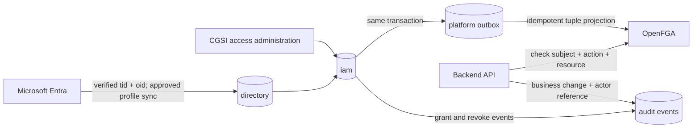

# Data platform, directory, authorization, and privacy blueprint

**Status:** implementation foundation landed; operational rollout and remaining workflows are listed below  
**Scope:** PostgreSQL, the CGSI employee directory, app authorization, audit history, observability, and secret/key management

## Current state

- `infra/postgres/init/001_create_schemas.sql` creates the app, directory, IAM, audit, and platform schemas on a fresh volume. Existing volumes are upgraded by versioned migrations; no volume reset is required.
- `infra/postgres/migrations` now defines local directory/IAM/audit/outbox/session tables, baseline roles and permissions, and a restricted `cgsi_identity` database login. The identity service uses that login for sessions and directory work. OpenFGA still uses its existing `cgsi_admin` login to preserve the existing engine-managed datastore.
- Microsoft Entra sign-in validates tenant, client, and object ID claims. The application requests `openid`, `profile`, and `email`; it does not call Microsoft Graph, and directory fields currently come only from those verified token claims.
- After verified Entra sign-in, the identity service upserts a minimal local employee and immutable Entra identity mapping. New employees receive the baseline `all-employees` group, a sign-in/provision audit event, and a durable outbox event. The outbox worker projects that group membership to OpenFGA before issuing a new session.
- Local groups, roles, permissions, group-role mappings, employee grants, audit events, and the OpenFGA projection outbox now exist. Starter app roles are seeded, but role grants are not yet consumed by application APIs, and the raw tuple administration endpoint remains available without the new IAM audit workflow.
- OpenFGA and application sessions use the same PostgreSQL instance. OpenFGA owns its own tuple/model persistence; its tables should remain engine-managed.
- Go backend services and the Node identity service now emit redacted OTLP logs, metrics, and HTTP traces with W3C trace propagation to the existing Collector pipeline. PostgreSQL spans and selected service-to-service spans are included.
- An optional persistent single-node OpenBao Compose profile and local setup guide now exist. Application credentials are still environment-driven; OpenBao issuance, renewal, and credential reload are not wired into service runtime.

## Decisions to adopt

1. **Entra authenticates; CGSI authorizes.** Entra's tenant ID and immutable object ID identify the external principal. CGSI owns employee-to-app access, groups, roles, and grants.
2. **Keep a minimal local employee projection.** Store only the attributes needed for CGSI screens, workflows, and authorization. Synchronize the approved Entra fields into the local directory; do not make every app query Graph at runtime.
3. **Keep SQL as the administrative source of truth for directory and grants.** OpenFGA evaluates relationship checks and holds a derived projection. A transactional outbox and periodic reconciliation keep that projection in sync.
4. **Separate business audit from observability.** PostgreSQL audit events record user-visible and administrative changes. Loki logs, Prometheus metrics, and Tempo traces explain service behavior; they are not the business history store.
5. **Use versioned SQL migrations and service-specific database roles.** Application startup must not create or alter business tables. A migration runner applies reviewed migrations in a deterministic order.
6. **Start with OpenBao for self-hosted secret/key lifecycle experiments.** Use its database secrets engine for PostgreSQL dynamic credentials and Transit for application data encryption/signing use cases. Keep development and production operating modes distinct.

## Source of truth and ownership

| Data | Authority | CGSI copy/use |
| --- | --- | --- |
| Sign-in and immutable identity (`tid`, `oid`) | Microsoft Entra | Persist the provider, tenant, and subject mapping in `directory.external_identities`; never use mutable email as the identity key. |
| Basic directory profile (display name, work email, department/title/manager only if approved) | Microsoft Entra initially; HUMA/HR source when established | Store the minimum approved projection and its source/sync timestamp in `directory`. Entra account disablement must deactivate access locally. |
| Employment identifiers and lifecycle | CGSI HR process/HUMA when implemented | Local employee record; do not infer a termination decision from a missing Graph sync. Define an explicit disable/offboarding workflow. |
| Groups, roles, permissions, app/resource grants | CGSI | Authoritative rows in `iam`; OpenFGA tuples are derived. M365 groups may be imported later only through an explicit mapping and approval process. |
| CRM, billing, future HUMA and RDES business records | Owning CGSI application | Separate app-owned schemas, migrations, APIs, and retention rules. |
| Business change history | CGSI audit subsystem | Append-only `audit.events`; no secrets or unrestricted profile snapshots. |
| Operational telemetry | Services + OpenTelemetry SDKs | Structured logs to Loki, metrics to Prometheus, traces to Tempo via the Collector. |

The identity token contains a verified Entra object ID, email, and name. The identity service now creates or updates the minimal local record from those claims. Microsoft Graph synchronization remains pending until the additional attributes and narrow directory-read permission are approved.

## Target PostgreSQL layout

Keep the existing app schemas, add clear platform boundaries, and keep OpenFGA engine-owned tables separate from application-owned tables.

| Schema | Owner and contents |
| --- | --- |
| `directory` | Local employee projection, Entra identity links, organizational units, and sync status. |
| `iam` | Groups, roles, permission catalog, scoped role grants, group membership, and group-to-role assignments. |
| `audit` | Append-only security and business-administration events with explicit retention and redaction rules. |
| `platform` | Sessions and the transactional integration outbox. Keep sessions short-lived and outside audit payloads. |
| `cube` | Cube-specific persisted data, if/when needed. |
| `crm` | CDEX customer/CRM data. |
| `billing` | BILS invoices and finance data. |
| `huma` | HUMA HRIS data, added when the module exists; avoid duplicating its sensitive HR domain in generic directory tables. |
| `rdes` | RDES support/ticketing data, added when the module exists. |
| OpenFGA datastore | OpenFGA-managed migrations and tables. Prefer a dedicated database and login on the same Postgres server initially; do not edit OpenFGA-owned tables with CGSI migrations. |

### Core table families

**`directory`**

- `employees`: internal UUID, optional employee number, display name, approved work contact fields, org-unit and manager references, employment/access status, and created/updated timestamps.
- `external_identities`: employee UUID, provider (`entra`), tenant ID, immutable subject/object ID, linked timestamp, last authenticated timestamp, and unique `(provider, tenant_id, subject)` constraint. An employee can have more than one external identity over time without changing the employee UUID.
- `org_units`: stable internal ID, parent ID, name/code, source, and source key. Use a hierarchy without copying unnecessary directory details.
- `sync_runs` / `sync_cursors`: source, start/end, result, watermark, and counts. Store diagnostics without raw Graph responses or tokens.

**`iam`**

- `groups`: stable group ID, name, description, status, and owner. Use internal groups as the grant boundary; add external Entra group mappings as explicit links rather than conflating external and local groups.
- `employee_groups`: employee/group, effective start/end, grantor, revoker, and reason/reference.
- `roles`: stable key, app/resource scope, label, status, and description.
- `permissions`: stable permission key, app, resource type, action, and description (for example `billing.invoice.read` or `crm.customer.update`). Keep the permission catalog in reviewed migrations/code so production grants cannot invent arbitrary permissions.
- `role_permissions`: role-to-permission mapping.
- `group_roles`: group-to-role assignment, optionally scoped to a resource or org unit, with effective dates and grant/revoke metadata.
- `employee_roles`: direct exception grants, disabled by default in normal administration and always time-bounded/reasoned when used.
- `external_group_links`: mapped Entra group ID to local group ID, sync state, and source metadata. Never import all tenant groups or memberships implicitly.

Use foreign keys, uniqueness constraints, check constraints, and indexes for active membership and identity lookups. Store grant/revocation metadata on assignment rows so current state and lifecycle remain queryable; emit every grant/revocation to `audit.events` as well.

**`audit` and `platform`**

- `audit.events`: event UUID/time, actor employee ID or service identity, action, outcome, target type/ID, source, request/correlation ID, optional reason/ticket reference, and a deliberately allowlisted, redacted JSON diff.
- `platform.outbox_events`: event ID, aggregate type/ID, event type/version, minimal JSON payload, attempt count, creation and delivery times. Insert the outbox row in the same transaction as an IAM grant change. A worker applies idempotent OpenFGA tuple writes/deletes and retries failures; a reconciliation job repairs drift.
- `platform.user_sessions`: keep the current session store here with expiry and scheduled cleanup. Do not copy session cookies, bearer tokens, authorization codes, or MSAL credentials into audit events.

`audit.events` should be append-only for service accounts: grant the writer `INSERT` and `SELECT`, not `UPDATE` or `DELETE`. Use a separate restricted retention/partition-maintenance role for retention operations. A database owner can always alter storage, so append-only grants provide application-level protection, not tamper-proof storage against a database administrator.

## Authorization flow

Every API remains fail-closed when identity or authorization is unavailable. Keep OpenFGA model versions in source control. Define the mapping from each CGSI role/permission to an OpenFGA relation in reviewed code/model changes. Do not let a raw admin tuple endpoint become the normal grant workflow: administrative writes should validate actor authority, record a reason, commit IAM plus audit plus outbox atomically, and then update OpenFGA asynchronously. Retire or tightly restrict direct tuple writes after the new path is live.

Offboarding must disable the local employee, revoke sessions, end active group/direct grants, and enqueue OpenFGA deletions in one audited workflow. Entra sign-in alone must never recreate access that CGSI has explicitly disabled.

## Database access and migration boundaries

- Replace runtime use of `cgsi_admin` with distinct logins: migration/bootstrap, identity/session, directory/authorization administration, OpenFGA, catalog, CRM, Billing, and future HUMA/RDES. Give each only the schema/table grants needed. A service that needs employee data should use a narrow directory API/read view, not broad access to all HR columns.
- Run schema/role setup and versioned SQL migrations as an explicit one-shot deployment step. Keep `docker-entrypoint-initdb.d` for initial database/bootstrap setup only; it will not upgrade an existing named volume.
- Give every migration an owner and rollback/forward-fix policy. Use transactional migrations where supported, an advisory lock to prevent concurrent migration runners, and a recorded schema version. Do not run DDL from request-serving replicas.
- Keep OpenFGA migrations under OpenFGA's own migration command and credentials. Do not couple their internal table schema to application migrations.
- Use separate local, test, staging, and production databases/credentials. Do not copy production directory or business records into developer Compose volumes.

## Privacy by default and by design

1. **Minimize:** start with stable identity link, display name, work email, active/disabled state, and only the org attributes a real feature needs. Do not add DOB, home address, personal phone, government ID, medical/payroll details, or full Microsoft profile blobs to the shared directory.
2. **Purpose and classification:** maintain a field inventory with purpose, owner, source, sensitivity, access roles, and retention. HUMA payroll/disciplinary/health data, if ever required, belongs in purpose-built restricted tables, never generic directory/session records.
3. **Least access:** schema-scoped DB roles, narrow APIs, privileged-grant workflows, separate admin credentials, and access logging for sensitive reads. Add row-level security only where the data model needs per-tenant/person boundaries and test its bypass behavior; it is defense in depth, not a substitute for service authorization.
4. **Safe defaults:** new employees receive only baseline Cube access needed to sign in. CDEX, BILS, HUMA, RDES, privileged roles, and record-level access require an explicit approved grant. Disable stale or unmapped external identities; fail closed on sync/authorization errors.
5. **Minimize telemetry:** never log passwords, secrets, cookies, authorization headers/codes, session IDs, request bodies, or full Entra claims. Do not use email, employee number, Entra object ID, customer IDs, or invoice IDs as Prometheus labels. Use opaque request/trace IDs and bounded service/route/status attributes. Redact query strings and error messages before export.
6. **Lifecycle:** define retention per data class before production. Provide an offboarding and correction workflow, controlled employee-record export, backup expiry, and deletion/anonymization rules. Keep audit evidence only as long as its approved purpose requires; redact identifiers in retained events when direct identity is no longer needed.
7. **Protection:** require TLS for production service/database links, encrypt backups and disks, keep keys outside the database, rotate credentials, restrict support access, and practice restore and incident-response procedures. Keep local Compose fallback credentials strictly local.
8. **Review:** threat-model new directory fields, exports, integrations, and privileged permissions before implementation. Record the data purpose, collection path, readers, retention, failure behavior, and audit event for each feature.

Retention durations are intentionally not guessed here; CGSI should approve the business/security schedule before production. Current Prometheus retention is 15 days, but that is not a policy for directory, audit, Loki, or Tempo data.

## Logging, monitoring, and tracing integration

Instrument both Go services and the Node identity service with OpenTelemetry SDKs and send OTLP to `otel-collector:4317` or `:4318` on the Compose network. Preserve the current Collector -> Tempo/Loki/Prometheus -> Grafana path.

- **Logs:** structured JSON to stdout, then Collector to Loki; include service, environment, severity, route template, status, duration, trace ID, and a pseudonymous actor reference only when needed. Use request IDs across gateway and internal calls. Add redaction at middleware boundaries.
- **Metrics:** request count, error count, latency histograms, dependency availability/latency, DB pool use, and outbox depth/age. Keep labels low-cardinality: service, route template, method, status class, dependency. Alert on sustained error rate/latency, unhealthy database/auth dependencies, and stuck IAM outbox work.
- **Traces:** instrument inbound HTTP, internal HTTP, PostgreSQL, OpenFGA, and future RabbitMQ operations. Propagate W3C trace context, but never put PII, tokens, SQL parameters, or entire request/response bodies in span attributes.
- **Audit:** use explicit application events for sign-in outcome, employee disablement, membership/role changes, permission administration, and access to sensitive HR records. A successful HTTP access log is not a substitute for these events.
- **Privacy checks:** add shared log/trace attribute allowlists and redaction tests before enabling collection in production. Limit telemetry access and retention separately from business audit access.

## Secrets and key rotation in Compose

### Recommendation: OpenBao

OpenBao is the recommended self-hosted candidate for this stack because its database secrets engine can issue leased PostgreSQL credentials and its Transit engine provides versioned keys for encryption/signing operations. This covers both credential lifecycle and managed application key use, while keeping PostgreSQL root credentials out of every application container. For database access, create a dedicated OpenBao database-control account and service-specific generated roles; never let OpenBao rotate the only human recovery/superuser account.

Docker Compose secrets are still useful for bootstrapping the OpenBao server and for a small number of local static files: Compose mounts only explicitly granted secrets as files under `/run/secrets/<name>`, avoiding broad environment-variable exposure. A mounted file by itself does not provide dynamic issuance, access policy, lease revocation, rotation, audit, or automatic application reload. Current services and OpenFGA URI configuration also need file-based/secret-manager integration before Compose credentials can be removed from environment variables.

Run OpenBao in a persistent, non-dev server mode for any environment whose data must survive restarts. Dev mode starts initialized/unsealed with in-memory storage and loses data on restart; it is for experiments only. A persistent single-node Compose instance still has manual initialization/unseal and recovery-key operations unless an external KMS/HSM is configured, so it is a developer integration target rather than a production HA design. Production needs TLS, persistent/HA storage, backed-up recovery material, audit devices, narrowly scoped machine identities/policies, and a supported auto-unseal/recovery plan.

OpenBao Transit key rotation creates a new key version for future operations; existing ciphertext remains readable with older key versions until it is rewrapped or old versions are deliberately retired. This is different from changing `SESSION_SECRET`: session-cookie signing secrets require application-aware key overlap/migration or a planned session invalidation, not Transit database encryption. Rotate each secret according to its consumer's reload and revocation behavior.

### Current implementation and rollout

1. The optional OpenBao profile is present for local experiments with persistent storage, loopback-only API/UI, and no default application dependency.
2. OpenBao policies, machine identities, PostgreSQL dynamic users, and Transit usage have not been configured. Services still read credentials from environment variables.
3. Add secret-file/OpenBao client support, lease renewal, credential reload, and graceful database-pool replacement before moving any service credentials.
4. Pilot with a non-critical service and exercise expiry/revocation, sealed/restart behavior, rotation, and backup recovery before production adoption.

## Implementation sequence

1. **Foundation landed:** additive schema migrations, `cgsi_identity` role, starter IAM catalog, sessions, audit and outbox tables. Apply with Compose against the existing persistent volume; keep its current data.
2. **Directory first-login landed:** token-claim based local employee provisioning, immutable Entra identity link, baseline group, audit event, and session profile lookup. Approved Microsoft Graph synchronization is still pending.
3. **IAM partially landed:** local group/role/permission schema and starter catalog, all-employees OpenFGA projection, retrying outbox, and group-aware authorization model. Still needed: audited administrative grant/revoke APIs, employee offboarding/session revocation, periodic reconciliation, and retirement/restriction of raw tuple administration.
4. **Telemetry foundation landed:** Go/Node OTLP logs, metrics, HTTP traces, redaction, and trace propagation. Still needed: dashboards/alerts, database instrumentation coverage, operational retention/access review, and production redaction review.
5. **Domain schemas:** add CDEX, BILS, then HUMA/RDES tables with service-owned migrations, field inventories, API authorization checks, audit hooks, and per-domain retention.
6. **Secrets:** optional OpenBao Compose profile and setup guide landed. Still needed: scoped policies, dynamic PostgreSQL credentials, application secret loading/renewal, tested rotation, and production HA/KMS/recovery procedures.

## Initial implementation boundary

The foundations above are implemented in the repository but have not been applied to the running Compose stack in this turn. The next runtime step is to run the migrations against the existing volume, then verify first-login provisioning and telemetry. The migration runner needs the existing `cgsi_admin` credentials to match the initialized PostgreSQL volume; if the earlier password-authentication error persists, reconcile that credential first without deleting the volume. Preserve current OpenFGA/session data and migrate incrementally. No Graph sync, IAM admin UI/API, business-domain tables, or production-ready secret rotation is claimed here.

## References

- [OpenBao database secrets engine](https://openbao.org/docs/secrets/databases/) — leased database users and PostgreSQL support.
- [OpenBao Transit secrets engine](https://openbao.org/docs/secrets/transit/) — versioned encryption keys, encrypt/decrypt, and rewrap.
- [OpenBao dev server](https://openbao.org/docs/concepts/dev-server/) — development-only in-memory behavior.
- [OpenBao seal/unseal concepts](https://openbao.org/docs/concepts/seal/) — startup, recovery, and auto-unseal tradeoffs.
- [Docker Compose secrets](https://docs.docker.com/compose/how-tos/use-secrets/) — explicit per-service file mounts at `/run/secrets`.
